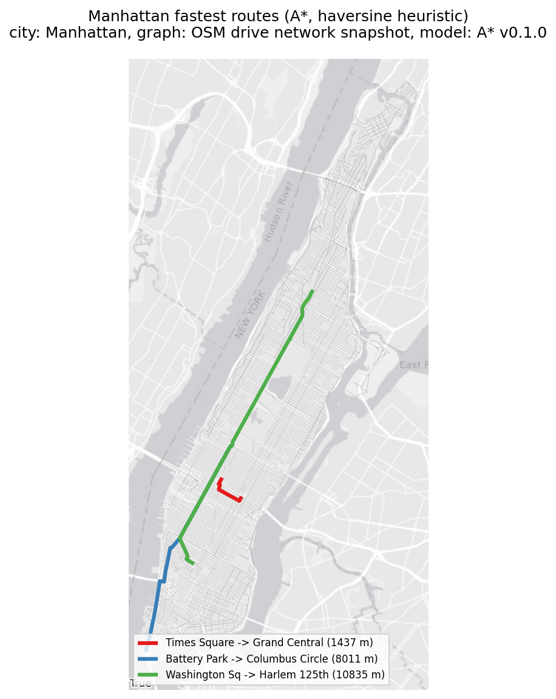
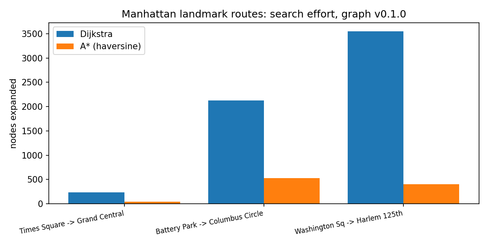

# street-graph-routing-osmnx

**Question:** how do we compute fastest routes on a real street network?

This project runs Dijkstra and A* on the OpenStreetMap drive network of Manhattan. The A* heuristic is the haversine straight-line distance to the goal. Results are checked against `networkx`.

Part of the [uber-like systems portfolio](https://github.com/Patotricks15/uber-like-systems-design-projects) (RT01).

## Results

| Route | Dijkstra (m) | A* (m) | networkx (m) | Dijkstra expanded | A* expanded |
|---|---|---|---|---|---|
| Times Square -> Grand Central | 1437 | 1437 | 1437 | 232 | 44 |
| Battery Park -> Columbus Circle | 8011 | 8011 | 8011 | 2129 | 525 |
| Washington Sq -> Harlem 125th | 10835 | 10835 | 10835 | 3547 | 404 |

Over 200 random node pairs, the largest difference between A* and networkx is 0.000000 m.





## Method

- **Graph:** `osmnx` drive network of "Manhattan, New York City, New York, USA", with `add_edge_speeds` and `add_edge_travel_times`. The graph is cached to GraphML so reruns need no network access. The snapshot has 4,635 nodes and 9,918 edges.
- **Weight:** edge `length` in metres. Parallel edges use the smallest weight.
- **Dijkstra:** binary heap with lazy deletion.
- **A\*:** heuristic `h(n) = haversine(n, goal)`. Edge lengths in OSM are never shorter than the great-circle distance, so `h` is admissible and A* returns the optimal path. A* refuses `weight="travel_time"` because the heuristic is not admissible for times.
- **Map:** route overlay on an Esri light-grey basemap, EPSG:3857.

## Deviations from the plan

- **Basemap:** the plan asks for `CartoDB.Positron`. CartoDB now requires an API key, and I do not have one. The map uses `Esri.WorldGrayCanvas`, which needs no key, with attribution shown. OpenStreetMap tiles were tried first and returned HTTP 403 to scripts.
- **Data:** the graph comes from Overpass, not from Kaggle. The plan's Kaggle read rule does not apply to OSM data.

## Reproduce

```bash
pip install -e ../routes-pricing-shared
pip install -e ".[dev]"
export UBER_DATA_DIR=~/uber-data   # cache directory, see data/README.md
make test
make notebook                       # executes notebooks/01_street_routing.py
```

## Layout

```text
src/street_routing/search.py   Dijkstra, A*, path length
src/street_routing/nodes.py    nearest OSM node lookup
notebooks/01_street_routing.py  analysis (jupytext percent format)
tests/test_search.py            optimality and heuristic checks
reports/figures/                exported maps
data/README.md                  source, licence and retrieval date
```

## Limitations

- The graph covers Manhattan only. Routes that leave the island are not computed.
- There is no traffic. Travel time uses OSM default speeds.
- Ground-truth trajectories are not used, so the route-length-error metric from the plan is not computed here. Optimality is checked against networkx.
